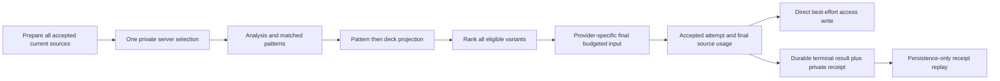

# Narrative Builder Architecture Diagram

Type: reference
Status: active reference
Last reviewed: 2026-10-23

## Source Precedence Contract

Spread understanding follows a strict precedence order so enrichment never overrides drawn-card truth:

`spread/cards > validated matched vision > current question/notes/card reflections/effective paths > saved interests and compatible memories > GraphRAG > ephemeris`

Guardrail: Enrichment layers may add nuance, but they must not replace drawn card identity, card count, or position semantics. Current inputs override saved interests and stored memory; saved focus cannot authorize a personal fact. Catalog meaning is resolved by identity/orientation; caller interpretation is separate untrusted context.


The implemented reading-context sequence is:



Classification precedes the bounded query projection. Query/excerpt coverage, selected candidates and final payload inclusion are separate. Candidate memories are conservatively selected once (100 candidates, three selected) and complete retained blocks determine accepted-attempt inclusion. Each provider attempt owns its metadata; rejected attempts and canned safety replacement do not lend source-use claims to accepted text. Public usage proves inclusion, never attention or reliance.

Jobs atomically write terminal state and a separate private `readingMemoryReceipt` key. Cancellation before the acceptance guard wins; overlapping cancellation after that guard cannot undo acceptance. Public success and DB stamping follow durable completion. Restart replay validates the accepted identities and performs only the original idempotent DB update, never generation. Direct access persistence can be lost on process termination. Private memory IDs/run/attempt mappings remain outside metadata, events and snapshots. Older envelope rewrites can remove replay identity even if receipt bytes survive; accounting continuity requires receipt-aware or drained compatible rollback. See the [reading input/source-use contract and release checklist](../reading-context-inputs.md), [ledger](../knowledge-graph/REMEDIATION_LEDGER.md) and [qualification status](../knowledge-graph/QUALIFICATION_STATUS.md).

```
┌─────────────────────────────────────────────────────────────────────────────┐
│                        TAROT READING REQUEST                                 │
│                    (question, spread, cards, reflections)                    │
└───────────────────────────────────┬─────────────────────────────────────────┘
                                    │
                                    ▼
┌─────────────────────────────────────────────────────────────────────────────┐
│                  VALIDATION & AUTHENTICATION LAYER                           │
│  • Schema validation (safeParseReadingRequest)                              │
│  • User authentication (getUserFromRequest)                                 │
│  • Rate limiting (enforceApiCallLimit)                                      │
│  • Vision proof verification (verifyVisionProof, optional)                  │
└───────────────────────────────────┬─────────────────────────────────────────┘
                                    │
                                    ▼
┌─────────────────────────────────────────────────────────────────────────────┐
│                            CRISIS DETECTION                                 │
│  • Self-harm signals                                                        │
│  • Medical emergencies                                                      │
│  • Mental health                                                            │
└───────────────────────────────────┬─────────────────────────────────────────┘
                                    │
                 ┌──────────────────┴──────────────────┐
                 │                                     │
                 ▼                                     ▼
┌─────────────────────────────┐      ┌───────────────────────────────────────┐
│ SAFE FALLBACK               │      │ SPREAD ANALYSIS                        │
│ • Gentle response           │      │ • Themes detection                     │
│ • Resource links            │      │ • Reversal framework                   │
│ • Early return              │      │ • Stored memory                        │
│ • Crisis resources          │      │ • GraphRAG retrieval                   │
└─────────────────────────────┘      │ • Elemental dignities                  │
                                     │ • Ephemeris context                    │
                                     └──────────────────┬────────────────────┘
                                                        │
                     ┌──────────────────────────────┴─────────────┐
                     │              BACKEND SELECTION              │
                     │  • availability and per-attempt A/B assignment      │
                     │  NARRATIVE_BACKEND_ORDER:                    │
                     │  claude-api → modal-qwen → openai-native →      │
                     │  local-composer                               │
                     │  openai-native = native OpenAI Responses      │
                     │  requires OPENAI_API_KEY                       │
                     └──────────────────┬──────────────────────────┘
                                        │
                                        ▼
             ┌─────────────────────────────────────────────────┐
             │           PROVIDER ATTEMPT LOOP                 │
             │  1. claude-api (Claude via Anthropic API)      │
             │  2. modal-qwen (Qwen via Modal)                │
             │  3. openai-native (OpenAI Responses)       │
             │  4. local-composer (deterministic fallback)   │
             └──────────────────┬──────────────────────────┘
                                        │
                                        ▼
            ┌─────────────────────────────────────────────────┐
            │         PROMPT CONSTRUCTION LAYER               │
             │   functions/lib/narrative/prompts/                │
             │   functions/lib/narrative/prompts.js (barrel)     │
            ├─────────────────────────────────────────────────┤
            │                                                 │
            │  ┌─────────────────────────────────────────┐   │
            │  │ buildEnhancedClaudePrompt               │   │
            │  │ • Token budgeting                       │   │
            │  │ • Section-aware truncation              │   │
            │  │ • GraphRAG passage injection            │   │
            │  │ • Deck-specific tips                    │   │
            │  │ • Astrological relevance                │   │
            │  └─────────────────────────────────────────┘   │
            │                     │                           │
            │                     ▼                           │
            │  ┌──────────────────────────────────────────┐  │
            │  │ SYSTEM PROMPT                            │  │
            │  │ • Role definition                        │  │
            │  │ • ETHICS section (critical)              │  │
            │  │ • CORE PRINCIPLES (critical)             │  │
            │  │ • MODEL DIRECTIVES (critical)            │  │
            │  │ • Deck style tips                        │  │
            │  │ • Position weights                       │  │
            │  │ • GraphRAG passages                      │  │
            │  │ • Ephemeris context                      │  │
            │  └──────────────────────────────────────────┘  │
            │                     │                           │
            │                     ▼                           │
             │  ┌──────────────────────────────────────────┐  │
             │  │ USER PROMPT                              │  │
             │  │ • User question                          │  │
             │  │ • Spread definition                      │  │
             │  │ • Cards with positions                   │  │
             │  │ • User reflections                       │  │
             │  │ • Context signals                        │  │
             │  │ • Stored memory (lower precedence)       │  │
             │  └──────────────────────────────────────────┘  │
             └─────────────────────────────────────────────────┘
                                    │
                                    ▼
            ┌─────────────────────────────────────────────────┐
            │    NARRATIVE HELPERS & SPREAD BUILDERS          │
             │   functions/lib/narrative/helpers.js                │
             │   functions/lib/narrative/spreads/*.js             │
            ├─────────────────────────────────────────────────┤
            │                                                 │
            │  ┌─────────────────────────────────────────┐   │
            │  │ buildPositionCardText                   │   │
            │  │ • Card name formatting                  │   │
            │  │ • Position interpretation               │   │
            │  │ • Reversal lens application             │   │
            │  │ • Elemental imagery                     │   │
            │  └─────────────────────────────────────────┘   │
            │                     │                           │
            │                     ▼                           │
             │  ┌─────────────────────────────────────────┐   │
             │  │ Spread-Specific Builders                │   │
             │  │ • CelticCross (spread-specific)         │   │
             │  │ • FiveCard (spread-specific)            │   │
             │  │ • ThreeCard (spread-specific)           │   │
             │  │ • Decision (spread-specific)            │   │
             │  │ • Relationship (spread-specific)        │   │
             │  │ • SingleCard (spread-specific)          │   │
             │  └─────────────────────────────────────────┘   │
             │  Spread-specific builders share common helpers  │
             │  and preserve position semantics.              │
             └─────────────────────────────────────────────────┘
                                    │
                                    ▼
             ┌─────────────────────────────────────────────────┐
             │           NARRATIVE GENERATION                  │
             │  • LLM inference or deterministic composition  │
             │  • Token streaming (native OpenAI path)   │
             │  • Response formatting                         │
             └───────────────────────┬─────────────────────────┘
                                    │
                                    ▼
             ┌─────────────────────────────────────────────────┐
             │     STRUCTURAL QUALITY GATE (PER ATTEMPT)       │
             │ functions/api/tarot-reading.js                 │
             │ functions/lib/readingQuality.js                 │
             ├─────────────────────────────────────────────────┤
             │                                                 │
             │  ┌─────────────────────────────────────────┐   │
             │  │ Narrative Validation                    │   │
             │  │ • Card coverage check                   │   │
             │  │ • Hallucination allowance              │   │
             │  │ • Spine completeness                    │   │
             │  │ • Position weight validation            │   │
             │  └─────────────────────────────────────────┘   │
             │                     │                           │
             │      ┌──────────────┴──────────────┐            │
             │      │ PASS                  FAIL  │            │
             │      ▼                             ▼            │
             │  ┌─────────┐              ┌──────────────┐     │
             │  │ Accept  │              │ Try next     │     │
             │  │ reading │              │ backend      │     │
             │  └────┬────┘              └──────┬───────┘     │
             │       │                          │             │
             └───────┼──────────────────────────┼─────────────┘
                     │                          │
                     └──────────┬───────────────┘
                                │
                                ▼
             ┌─────────────────────────────────────────────────┐
             │       OPTIONAL SYNC EVAL GATE / ASYNC EVAL      │
             │ • EVAL_GATE_ENABLED or selective policy        │
             │ • Safe fallback only for a blocked sync gate    │
             │ • Async Workers AI scoring via waitUntil()      │
             │ • D1 eval_metrics and optional prompt persistence│
             └─────────────────────────────────────────────────┘
                               │
                               ▼
            ┌─────────────────────────────────────────────────┐
            │              RESPONSE FINALIZATION              │
            │  • Add metadata (provider, requestId)           │
            │  • Add themes & analysis                        │
            │  • Add ephemeris context                        │
            │  • Add GraphRAG stats                           │
            │  • Add quality metrics                          │
            └───────────────────────┬─────────────────────────┘
                                    │
                                    ▼
             ┌─────────────────────────────────────────────────┐
             │              CLIENT RESPONSE                    │
             │  {                                              │
             │    reading: "Narrative text...",                │
             │    provider: "claude-api | modal-qwen |         │
             │      openai-native | local-composer",│
             │    themes: {...},                               │
             │    context: "love",                             │
             │    spreadAnalysis: {...},                       │
             │    graphRAG: {...}                              │
             │  }                                              │
             └─────────────────────────────────────────────────┘
```

For `claude-api`, `modal-qwen`, and `openai-native`, the prompt-construction layer
assembles system and user prompts. `local-composer` bypasses LLM prompt assembly and
uses the reasoning-aware spread builders directly.

## Production Reasoning Integration

`tarot-reading.js` calls `buildReadingReasoning()` after `performSpreadAnalysis()` and
returns the resulting `analysis.reasoning` metadata. The `local-composer` backend then
calls `buildReadingWithReasoning()` around the selected spread builder; supported
builders use the reasoning for intent-aware openings, connectors, emphasis, and
synthesis. LLM backends continue to use the same spread analysis and prompt path,
with the reasoning object available as metadata.

Normal reasoning local composition does not render direct pattern highlights, GraphRAG references, memories or caller interpretations; its usage reports `not_used_by_backend`. Lower-level no-reasoning spread builders may render safe pattern synthesis, and count only actual rendered inclusion. Explicit debug reference appendices do not establish normal reading use. UI/journal references use the accepted attempt's final retained indices/projected identities; the context-independent five-passage retrieval remains a preview. Summary-only references count as zero full passages; opaque unverifiable legacy references are omitted and unknown legacy counts stay unknown.

## Key Components

| Component | File | Status |
|-----------|------|--------|
| **Orchestrator** | `functions/api/tarot-reading.js` | Production request orchestration |
| **Backend registry** | `functions/lib/narrativeBackends.js` | Current provider order and dispatch |
| **Reasoning** | `functions/lib/narrative/reasoning.js` and `reasoningIntegration.js` | Integrated into analysis and local composition |
| **Prompt builder** | `functions/lib/narrative/prompts/` and `prompts.js` | Modular prompt assembly and budgeting |
| **Helpers** | `functions/lib/narrative/helpers.js` | Shared narrative helpers |
| **Spread builders** | `functions/lib/narrative/spreads/` | Position-aware spread construction |
| **GraphRAG** | `functions/lib/graphRAG.js` and `knowledgeBase.js` | Pattern retrieval and Tableu Tarot Canon passages |
| **Structural quality gate** | `functions/api/tarot-reading.js` and `functions/lib/readingQuality.js` | Coverage, hallucination, spine, and high-weight-position checks before acceptance |
| **Evaluation and metrics** | `functions/lib/evaluation.js` | Workers AI scoring, sync/async evaluation gates, and D1 `eval_metrics` |

## Critical Issues in Flow

### ✅ Issue #1: Late Crisis Detection (Resolved)
```
Current Flow:
  Request → Validation → Crisis Check → Spread Analysis → ...
```
**Impact:** Avoids wasted compute on blocked requests

### ✅ Issue #2: Token Budget Safety Gap (Resolved)
```
Current Behavior:
  if (criticalSections > 80% of budget) {
    throw new Error('PROMPT_SAFETY_BUDGET_EXCEEDED');
  }
```
**Impact:** Prevents safety guidance truncation

### ✅ Issue #3: Global State (Mitigated)
```
// helpers.js
let PROSE_MODE = false; // Legacy test helper

export function setProseMode(enabled) {
  PROSE_MODE = !!enabled;
}
```
**Status:** Mitigated via runtime guards in `isProseMode()`. Global state only honored
when `env.NODE_ENV === 'test'`. Production callers must pass `proseMode` explicitly.
No cross-request bleed in production.

## Data Flow Summary

1. **Request enters** → Validation + Auth (1-5ms)
2. **Vision proof** (if provided) verified; default mismatches remain telemetry-only
3. **Crisis check** performed (1-2ms)
4. **Spread analysis** computed (50-100ms)
5. **Reasoning chain** built from the actual spread and question
6. **Backend selected** in order: `claude-api` → `modal-qwen` → `openai-native` → `local-composer`
7. **Prompt or local composition** constructed (10-20ms):
   - Token budgeting and GraphRAG retrieval for LLM paths
   - Spread-specific sections and reasoning-aware synthesis
8. **Narrative generated** (1000-3000ms depending on backend)
9. **Structural quality gate** validated by `tarot-reading.js` and `readingQuality.js` (5-10ms)
10. **Async evaluation** scheduled by `evaluation.js` (doesn't block response)
11. **Response sent** to client and metrics persisted to D1 `eval_metrics`

## Runtime Scheduling and Storage

The Worker's daily `0 3 * * *` cron runs D1 quality analysis, ongoing legacy KV compatibility archival, and cleanup. Runtime reading metrics and evaluation payloads are written directly to D1 `eval_metrics`; `METRICS_DB` also stores current media telemetry and media-usage counters. `R2_LOGS` stores generated media, user-media objects, journal-export caches, and archives/exports.

## Optimization Opportunities

| Optimization | Savings | Complexity |
|--------------|---------|------------|
| Early crisis detection (done) | 50-100ms | Low |
| Lazy-load ephemeris | 20-40ms | Medium |
| Cache GraphRAG matches | 5-20ms | Medium |
| Parallel backend checks | 10-20ms | High |

## Testing Strategy

```
Unit Tests (functions/lib/)
├── Token budgeting
│   ├── estimateTokenCount edge cases
│   ├── truncateSystemPromptSafely
│   └── Critical section preservation
├── Input validation
│   ├── sanitizePromptValue (with template injection)
│   ├── Card count validation
│   └── Property existence checks
└── Narrative builders
    ├── Empty cardsInfo handling
    ├── Reversal framework application
    └── Position text generation

Integration Tests (e2e/)
├── Full reading flow
├── Crisis detection early return
├── Quality gate blocking
└── Vision proof mismatch

Performance Tests
├── Token estimation accuracy
├── GraphRAG retrieval latency
└── End-to-end timing
```

## Architecture Evolution Roadmap

### Phase 1: Quick Wins (Week 1)
- Move crisis detection earlier (done)
- Fail-fast on safety budget (done)
- Add template syntax filtering (done)
- Add input guards (done)

### Phase 2: Refactoring (Month 1)
- Split prompts.js into modules ✅ (now `prompts/` + barrel)
- Remove global state
- Extract spread builder base class

### Phase 3: Plugin System (Quarter 1)
```
narrative/
├── core/
│   ├── builder.js
│   ├── pipeline.js
│   └── registry.js
├── plugins/
│   ├── reasoning/
│   ├── graphRAG/
│   ├── astrology/
│   └── vision/
└── spreads/
    └── [use plugins via registry]
```

### Phase 4: Optimization (Quarter 2)
- Implement GraphRAG caching
- Lazy-load non-critical enrichments
- Parallel backend health checks

---

Status labels describe module responsibility and current integration; they are not size thresholds.
