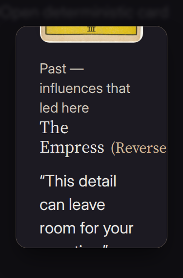
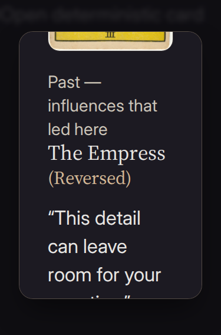

# Compact card inspection follow-up

At 200% text size, a reversed card name could join its orientation into one unbreakable line and overflow the card dialog. The title now includes a real word boundary and can wrap long words. The defect was reproduced with both Tailwind 3 and Tailwind 4 styles.

The images mount the actual `CardModal` component with compiled application CSS, The Empress reversed, and a 375 × 568 Chromium viewport at 200% text. The before case restores the original title markup and margin; the after case uses the corrected component. This is browser component evidence, not a physical-device or authenticated production test.

| Before | After |
| --- | --- |
|  |  |

The accompanying browser tests now exercise compact inspection through the current Card detail dialog, including paired artwork, keyboard and touch access, return focus, reduced motion, visible drawn-card labels, and overflow. The ordinary reading regression fixes wall-clock time to draw The Empress reversed while leaving timers running; it keeps the strict dialog overflow assertions.

The Tailwind configuration also expresses the existing short-height and orientation conditions as custom variants. This removes invalid container-width CSS without changing the conditions.

Validation:

- Root suite: 4,229 passed, 2 skipped.
- Gesture/deck/refinement suite: 33 passed across Chromium desktop, Chromium phone, and WebKit phone.
- After the custom-variant correction: all 9 affected compact/200%-text checks passed.
- Independent component review: reversed Empress and Temperance titles fit at 320px and 375px in Chromium and WebKit.
- Build and lint passed. The three generated-CSS warnings are resolved; the existing ONNX dependency `eval` warning remains.

Physical devices, assistive technology, live model quality, and authenticated production flows are separate acceptance work.
