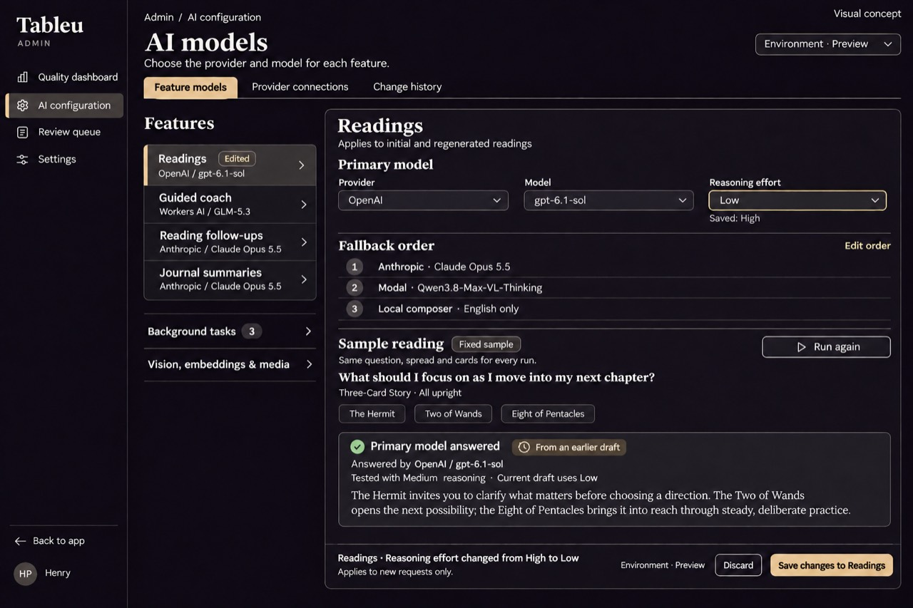

# Tableu admin AI configuration

Type: spec  
Status: implemented locally  
Last reviewed: 2026-11-19

An admin can change the model for one Tableu feature, try the draft on a fixed sample, see which provider actually answered, and save the change for new requests in the selected environment. Editing Readings covers both initial and regenerated readings. The implementation target is the final supplied desktop frame. Its sample result and environment are illustrative.

The local implementation is available at `/admin/ai-configuration`. See the [deployment and local setup notes](../../provider-reference.md#admin-ai-configuration) for environment selection and the production Readings rollout.



## The interaction to build first

1. Open **AI configuration → Feature models → Readings** in Preview. The saved primary is OpenAI / `gpt-6.1-sol` at High reasoning. Its fallback order is Anthropic, Modal, then Local composer.
2. Choose Medium. The field shows **Saved: High**, the feature row gains **Edited**, and the sticky footer describes the change. Run a sample. While it runs, the admin can continue editing.
3. When OpenAI answers and its output passes delivery checks, show **Primary model answered**, the answering provider and model, the requested reasoning effort, and an excerpt. A matching result carries **Current draft**.
4. Change Medium to Low. Retain the excerpt. Put **From an earlier draft** beside the success headline and show **Tested with Medium reasoning · Current draft uses Low**. Offer **Run again**. The footer now says **Readings · Reasoning effort changed from High to Low**, **Applies to new requests only**, and **Environment · Preview**.
5. **Save changes to Readings** publishes Low for this feature in Preview. A sample is optional. Freeze the submitted draft and mutation ID while the save is pending. On acknowledgement update the saved baseline and history, announce the save, and retain the sample’s actual settings. If the admin edited again during the save, keep those newer edits and recompute the diff. Otherwise clear **Edited**. **Discard** restores the most recently loaded saved settings and recomputes the sample’s label. Disable Save on a clean draft or during a pending save.

This sequence is the desktop acceptance fixture. A fresh visit starts clean with no sample. Build the illustrated state through interactions in browser tests.

## Screen and navigation

- Add `/admin/ai-configuration` to the React router, the non-reading route classification, and route titles. Preserve `/admin` for the quality dashboard. Share the admin auth gate and extract a common navigation shell. Link Review queue to the existing review surface and Back to app to the reader. Only render functional destinations. Use **Admin** for a shared credential. “Henry” and “Visual concept” belong to the reference frame.
- **Feature models** opens with Readings selected. At desktop size retain the admin rail, compact feature list, larger editor pane, three primary controls in a row, and the save bar at the bottom of the editor. Keep the four reader-facing assignments visible. Start **Background tasks (3)** and **Vision, embeddings & media** collapsed. Feature rows show the saved provider/model summary and an Edited marker when applicable.
- Scope edits to one feature. Retain the in-memory draft and sample when visiting the two sibling tabs. Before changing feature or environment, leaving the editor route, or reloading with dirty changes, offer a way to stay or discard. Use the browser’s supported unload prompt for reload. Clear private state on admin logout. Failed saves keep the draft and expose a retry.
- At narrow widths replace the rail with accessible navigation, stack the feature chooser and editor, and stack or wrap the three controls. The sticky bar must leave the final action and form field reachable at 320 CSS pixels, at zoom, and above the device safe area. Restore focus when closing edit order or discard dialogs. Give reorderable rows keyboard **Move up** and **Move down** buttons and announce saves, sample status and conflicts. Use text and icons alongside color.
- Use Tableu’s midnight ink and reading surfaces, candlelit brass for selection and the save action, the existing serif headings, and Inter controls. Use semantic theme tokens so the daylight theme remains legible. [Design tokens](../../../DESIGN.md) · [Current admin page](../../../src/pages/AdminDashboard.jsx) · [React routes](../../../src/components/AnimatedRoutes.jsx) · [Route announcements](../../../src/components/RouteAccessibility.jsx)

## Feature catalog and routing

Maintain one versioned server catalog, projecting its safe fields to the UI. Each entry declares feature ID, allowed primary adapters, allowed models per adapter, supported effort values, fallback rules, and fixture ID. Build its defaults from the deployment configuration and the actual task adapters. The table shows checked-in defaults. Credentials, entitlements and owner mode determine availability at runtime. [Provider inventory](../../provider-reference.md) · [Checked-in configuration](../../../wrangler.jsonc)

| Feature ID and label | Initial assignment and editor behavior |
| --- | --- |
| `readings` · Readings | OpenAI / gpt-6.1-sol / High → Anthropic / Claude Opus 5.5 → Modal / Qwen3.8-Max-VL-Thinking → Local composer. Show **Edit order** for the remote fallbacks and pin **Local composer · English only** last. Selecting an eligible fallback as primary swaps the previous primary into its slot. Keep each adapter once. Apply the existing language eligibility check to the local step. |
| `guided-questions` · Guided coach | Workers AI / GLM-5.3 / High for eligible question generation. Preserve free-tier templates, supplied draft handling, and local fallback. The setting controls suggested questions. |
| `reading-followups` · Reading follow-ups | Anthropic / Claude Opus 5.5, then OpenAI, then Modal. Offer Anthropic and OpenAI as eligible primaries with the other as next fallback. Keep Modal in its supported fallback role. Exhaustion produces the existing retry response. Preserve memory tools, consent, usage reservations and the caller’s stream mode. |
| `journal-summaries` · Journal summaries | Anthropic / Claude Opus 5.5, then OpenAI, then the local journal heuristic. Offer either remote primary and keep the heuristic last. Preserve journal eligibility and summary reservation/settlement. |
| `coach-action-extraction` · Coach action extraction | Workers AI / GLM-5.3-Flash / Low. Make the current code constant a feature-scoped setting for extraction from eligible saved entries, including backfill. Embedding selection is independent. |
| `reading-evaluation` · Reading evaluation | Workers AI / GLM-5.3 / Low. Apply to asynchronous grading. Keep its deployment enablement, timeout and telemetry policy. |
| `quality-gate` · Quality gate | Workers AI / GLM-5.3-Flash / Low. Label the checked-in mode **Selective**. This check can hold or replace a reading before delivery, even when the global gate switch is off. Display the effective policy in the expanded row. Model edits preserve mandatory checks and failure policy. |

Filter the model picker by feature and provider. For Workers AI, present only catalog entries tested for that task’s output contract and deadline. Keep a sole eligible provider visible as a fixed value. Offer **Task default** to inherit adapter behavior, including omitted reasoning settings. Hide the effort selector for a model without that control. When changing providers, reset incompatible child selections and show the resulting diff. Exclude credentials, endpoints, timeouts, safety toggles and arbitrary model strings from the edit contract.

For the first delivery, the expandable **Vision, embeddings & media** group is an inventory with effective settings and capabilities. Identify visual recognition and cue generation, semantic embeddings, and narration/media separately. These need different controls for recognition backends, vector compatibility and voice choices. Track their editors as subsequent work. **Provider connections** lists each adapter’s configuration status, missing binding or secret *names* where actionable, and dependent features. Distinguish “Configured” from a successful inference. An authenticated admin can replace, disconnect or restore supported provider credentials. The portal encrypts submitted values and returns only configuration status and revision. [Portal setup](../../provider-reference.md#admin-ai-configuration)

## Drafts, samples and provenance

Keep three distinct client values per active environment and feature. The **saved** value includes the server revision and defaults/catalog token. The **draft** is the normalized editable policy. A **sample receipt** records the immutable policy submitted, fixture version, attempt outcome and excerpt. Derive dirty state from normalized saved versus draft values. Derive sample freshness by comparing the submitted policy fingerprint, fixture version, environment and feature with the current view. Reverting exactly to a tested draft restores **Current draft**. An edit to the fallback order alone also invalidates the sample comparison.

Use a versioned, server-owned reading fixture. Its question is **What should I focus on as I move into my next chapter?** Use the canonical RWS deck, spread `threeCard`, and The Hermit, Two of Wands, and Eight of Pentacles, all upright in Past, Present, Future order. Resolve cards through the same catalog as a reader request. Keep the question, context and card inputs identical between runs. Generated prose can vary. Other text features get their own fixed synthetic input and native output preview, such as a suggested question, a follow-up on a synthetic reading, a summary of sample entries, an extracted action, a grade or a gate decision. [Spread definition](../../../src/data/spreads.js)

On explicit **Run sample reading** or **Run again**, the Worker validates the draft and executes the feature’s real prompt, selected adapters, deadlines, applicable safety checks and fallbacks against the fixture. A configured remote adapter can incur normal inference usage. Display the last completed excerpt while a rerun is pending, labeled as the previous run. Only the latest requested run can update that view. A failed run has a distinct failure state and retry action. Navigating or editing while a run finishes cannot attach its result to another feature or newer draft.

| Delivered outcome | Result treatment |
| --- | --- |
| Primary output accepted | **Primary model answered** with answering provider/model and requested effort. Use provider-reported model identity when supplied. Otherwise label the model as configured. |
| Remote fallback accepted | **First fallback answered** or the corresponding configured position. Show the answering adapter and the safe reason the primary was skipped or failed. A retry within one adapter keeps its position. |
| Local fallback delivered | **Local composer answered** for Readings. Omit model and effort. Use feature-specific copy for a template or journal heuristic. |
| Gate replacement, refusal, timeout or exhausted chain | Show the appropriate delivered safety outcome or **Sample failed**, with a bounded reason. Reserve the success headline for accepted provider output. |

Capture attempt provenance at the adapter boundary. The public reading response’s `reasoning` field describes spread analysis. Use the effort sent for the winning attempt and separately preserve the draft’s requested primary settings. Disable personalization and experiments for fixtures. Factor the side-effect-free work out of normal entry points. Sample mode excludes reader quotas, journals, memories, visual jobs, prompt archives, production grading queues, and user-facing analytics. Keep only short-lived admin run state. [Reading orchestration](../../../functions/api/tarot-reading.js)

For example, the completed result below stays identical when the admin subsequently selects Low. The editor derives **From an earlier draft** locally. In this example, `slot: 0` means the primary and `modelSource: "configured"` means the adapter did not report a model identity.

```json
{
  "runId": "sample-42",
  "environment": "preview",
  "featureId": "readings",
  "fixtureVersion": "three-card-story-v1",
  "policyFingerprint": "example-medium-draft",
  "status": "completed",
  "outcome": "primary_accepted",
  "requestedPrimary": { "providerId": "openai-native", "modelId": "gpt-6.1-sol", "reasoningEffort": "medium" },
  "attempts": [
    { "slot": 0, "providerId": "openai-native", "modelId": "gpt-6.1-sol", "modelSource": "configured", "effortSent": "medium", "outcome": "accepted" }
  ],
  "excerpt": "The Hermit invites you to clarify what matters before choosing a direction."
}
```

## Worker API and persistence

Register the following routes in the existing Worker router. Require server-side admin bearer verification on every endpoint, including sample polling. Return `Cache-Control: no-store`. Hosted access uses the deployment admin credential. Local browser access also accepts an expiring, revocable session issued after local password setup. Record a shared admin actor and attach a request ID. Named attribution requires a future authenticated admin identity. [Admin auth gate](../../../src/components/admin/AdminAuthGate.jsx) · [Worker authentication convention](../../../functions/api/admin/quality-stats.js) · [Worker routes](../../../src/worker/index.js)

All paths below are relative to `/api/admin/ai-configuration`. The deployment supplies the environment identity and bindings. Local owner endpoints also verify the signed-in Tableu reader. The server derives the reader identity from the session cookie.

| Method and path | Contract |
| --- | --- |
| `GET /` | Environment, write capability, catalog version, feature groups, eligible controls, normalized saved policies, revision and base token per feature. Use this endpoint to initialize or refresh the editor. |
| `GET /connections` | Allowlisted configuration states per adapter, binding requirements and feature usage. No secret values or raw provider responses. Render an actionable reason for an unavailable choice. |
| `PUT /connections/:providerId` | Require a matching base revision. Replace all credentials for the provider, disconnect it, or restore its deployment settings. Return only the updated connection metadata. |
| `GET /owner-subscription` | On the local Worker, return the signed-in reader, link revision, editability and host login availability. A different reader receives a read-only explanation. |
| `PUT /owner-subscription` | Accept `{baseRevision, providerId}` to link or switch between Codex / ChatGPT and Claude Code. A null provider unlinks the reader. An existing link requires the same reader. |
| `POST /owner-subscription/samples` | Accept `{baseRevision, runId}` from the linked admin and reader. Queue the fixed three-card question once on the selected subscription and return HTTP 202. |
| `GET /owner-subscription/samples/{runId}` | Poll with both credentials. A completed receipt contains the provider, an excerpt and any available model provenance. Switching or removing the link revokes access to the old receipt. |
| `PUT /features/{id}` | Accept `{baseRevision, baseToken, mutationId, policy}`. Validate and save one feature. Return the saved policy, committed revision and its base token. For a fresh mutation with the current base but no changes, return `422 no_changes` and create no revision. |
| `POST /features/{id}/samples` | Accept `{catalogVersion, runId, policy}`. Validate and snapshot the draft, select the server fixture, and return `202` with a poll URL. It never publishes the draft. |
| `GET /features/{id}/samples/{runId}` | Return pending, running, completed or failed. A terminal receipt includes the input fingerprint, fixture version, primary requested, accepted source, configured position, typed attempt outcomes, and bounded display output. |
| `GET /history?feature=&cursor=` | Newest first, with stable cursor pagination and optional feature filter. Each row gives feature, environment, UTC time, actor, revision, and field-level before/after diff, including order changes. Samples and discarded drafts do not enter history. |

Use a schema-versioned policy with `primary` and ordered `fallbacks`. A remote step has `providerId`, `modelId` and optional `reasoningEffort`. Local steps have a typed adapter ID. Fixed feature fallbacks are supplied or verified by the server. Canonicalize field order and inherited values before hashing. Reject unknown fields, wrong-capability providers/models, illegal efforts, duplicate adapters, or movement of a pinned terminal step with field-level `422`. List unconfigured adapters truthfully. Prevent selecting a newly unconfigured primary, while allowing existing optional fallback slots to remain configured but unavailable. Runtime still skips unavailable adapters per feature policy.

Add a numbered D1 migration for append-only `ai_feature_config_revisions`. Store environment, feature ID, revision, schema/catalog version, canonical policy, before/after diff, issued base token, server timestamp, actor kind, request ID, mutation ID and request digest. Unique keys cover `(environment, feature, revision)` and `(environment, feature, mutation_id)`. The latest row is the saved policy and history entry. Revision zero is the existing deployment/adapter default. A feature with no saved row behaves exactly as it did before installation.

Use a conditional insert against the expected latest revision so publishing and auditing are one atomic operation. Check for an already committed mutation first. Replaying its original payload returns the original receipt, even after a later save. A different payload for that committed ID returns `409`. For a fresh ID, compare the base token with the active catalog/defaults and revision, then check for a real change. Losing a concurrent save or submitting a stale base returns `409`. Keep local edits on conflict, fetch the current saved values and show which fields changed. Offer **Reload saved** or let the admin explicitly reapply their edits against the new base. Validation and storage errors never report a successful save. Use authoritative reads at admission so requests accepted after a save see the acknowledged revision.

Use a short-lived admin sample job for long-running inference. Reuse the existing Durable Object job lifecycle patterns with an admin-only storage namespace and status handler. Index by environment, feature and run ID. Coalesce duplicate starts, reject a different payload for the same ID and bound active runs per deployment. Respect task deadlines. Treat an interrupted attempt with unknown provider completion as failed and let the admin explicitly rerun. Expire the fixture output and receipt 15 minutes after completion. A locally displayed result can remain in the open editor. Return `401` for invalid credentials, `429` for sample capacity, and an actionable unavailable state for missing admin storage or deployment configuration.

## Applying saved changes to real requests

1. Introduce a Worker-side feature policy resolver alongside the existing adapters and a shared serializable contract for the editor. Check deployment/owner routing and eligibility first. Public assignments apply to eligible public work. Preserve current personal-subscription routing and its isolation from paid fallback paths. Pass model/effort per call or via a request-scoped adapter configuration. Never mutate the shared Worker environment. [Owner routing](../../../functions/lib/personalTextProvider.js) · [Reading backend registry](../../../functions/lib/narrativeBackends.js)
2. Pin the effective policy and revision when admitting new work. For web and MCP reading jobs, carry a trusted, credential-free policy through `startReadingJob` into Durable Object storage, separate from the MCP principal/request snapshot. The direct reading route resolves once at its own admission. Streaming eligibility, buffered attempts, structural retries, gate decisions and fallback traversal must use the same resolved policies. Pin the grader/gate assignments used by that reading, too. A regenerated reading is newly admitted. Reconnect, cancel, retry within a job, and work already accepted retain their original settings. Jobs created before rollout without a policy use legacy behavior through completion. [Job admission](../../../functions/lib/readingJobs.js) · [Job execution](../../../src/worker/readingJob.js)
3. Preserve each adapter’s deadlines and streaming semantics. Once output has been committed to the client, follow the existing stream failure behavior. Follow-up JSON, SSE and memory tool continuations must all receive the chosen model and applicable effort. Repairs stay with the adapter/model that answered and retain their dedicated effort policy. Make the extraction override reach journal saves and backfill. Freeze settings for queued background work at scheduling. [Follow-ups](../../../functions/api/reading-followup.js) · [OpenAI stream helpers](../../../functions/lib/openaiResponsesStream.js) · [Journal summaries](../../../functions/api/journal-summary.js) · [Guided questions](../../../functions/api/generate-question.js) · [Extraction](../../../functions/lib/coachSuggestion.js) · [Evaluation](../../../functions/lib/evaluation.js) · [Selective gate](../../../functions/lib/evalGatePolicy.js)
4. Roll out the resolver per deployment after its migration. With the resolver disabled, the existing routes use their existing defaults. With it enabled, distinguish an empty revision history from a storage failure. On lookup failure, use the feature’s existing unavailable/error outcome and retain mandatory safeguards. Repair through a subsequent revision or disable the resolver in that deployment to return to the shipped routing policy. Keep history intact.

## Environments and delivery

The checkout declares a D1 binding and has no separately defined hosted Preview D1 environment. Start with the local Worker and local D1. Enable the **Preview** label on an explicitly isolated deployment with its own config storage, job namespaces and intended provider bindings. Each Worker serves its own environment. List only configured environment destinations, navigate to their own admin origins, and authenticate there. Never forward a bearer between origins. With one destination, render the environment as a fixed value.

Ship the first end-to-end slice with Readings, read-only connection status, and the history generated by real saves. Follow with the remaining six text editors, their fixtures and route integrations. Enable an editor’s Save action only when its normal runtime consumer honors the setting. Keep the specialist inventory available throughout.

Production Readings has an additional dependency. Today the release gate derives its backend from the static reading order and deployment defaults. Before enabling production Readings writes, make release qualification consume the effective production primary/model/effort and deadline, including the revision or fingerprint in its evidence. Keep the existing allowed qualification backends and credential scope. Only offer production primaries supported by that policy, and fail release verification if the effective settings cannot be resolved. A dashboard sample supplies diagnostic feedback. The release gate supplies release evidence. [Gate runner](../../../scripts/evaluation/runReleaseChecks.js) · [Qualification backend selection](../../../scripts/evaluation/lib/subscriptionNarrative.js)

## Acceptance and verification

| Check | Passing evidence |
| --- | --- |
| Visual and keyboard | Browser walkthrough reaches the exact High saved / Medium tested / Low draft frame. Compare at the reference desktop size, narrow width and zoom. Test both themes, focus order, announcements, keyboard reorder, and sticky footer clearance. |
| Editor lifecycle | Clean, edit, discard, save, stale sample, exact revert, fallback reorder, tab return, guarded navigation, validation failure and conflict all leave saved, draft and tested values truthful. Edit again during a save and check that the acknowledgement preserves the newer edit. An older async response cannot replace a newer run or draft. |
| Capability and access | Guest, ordinary signed-in and Pro accounts without the admin bearer cannot read, write or run samples. Local admin can. Cover missing credentials, partial Modal credentials, wrong-feature models, owner isolation and separate environment data. Use safe fixtures and redact auth from evidence. |
| Runtime parity and isolation | With no revision, compare the actual adapter calls and fallbacks with today’s behavior across all seven features. With an override, observe it in that feature’s real entry points and verify the neighboring features still use their own settings. Test free guided questions, journal entitlements, forced gates, follow-up tool/repair paths and unsupported-language local fallback. |
| Admission and concurrency | An admitted reading keeps its revision across DO restart, SSE reconnect and fallback. The next regeneration uses the new revision. Simultaneous saves from the same base yield one winning row. Identical retries return one receipt. Storage failure, catalog change and a pre-migration job have explicit outcomes. |
| Sampling | Stub providers to exercise primary success, remote and local fallback, safety replacement, failure, slow completion, duplicate start and expiry. Check actual adapter payload and delivered source. Verify zero reader usage reservations, journal/memory/visual writes and production metrics for samples. |
| Release | Readings qualification selects the supported effective production primary with the expected model, effort and deadline. Preview changes cannot alter the production release input. |

Extend the root and Worker suites around the existing [reading job tests](../../../tests/readingJob.test.mjs), [follow-up tests](../../../tests/readingFollowup.test.mjs), [owner isolation tests](../../../tests/codexSubscriptionIsolation.test.mjs), and [release checks](../../../tests/releaseChecks.test.mjs). Add Playwright coverage through the real local admin route with fixture providers. For implementation verification run `npm test`, the affected Worker tests, the focused Playwright spec, `npm run test:a11y`, `npm run lint`, `npm run build`, and `npm run docs:check`. Run `npm run ci:narrative-check` for narrative changes and the existing release check for release qualification. Record browser, fixture-provider, live-provider and release results separately.
